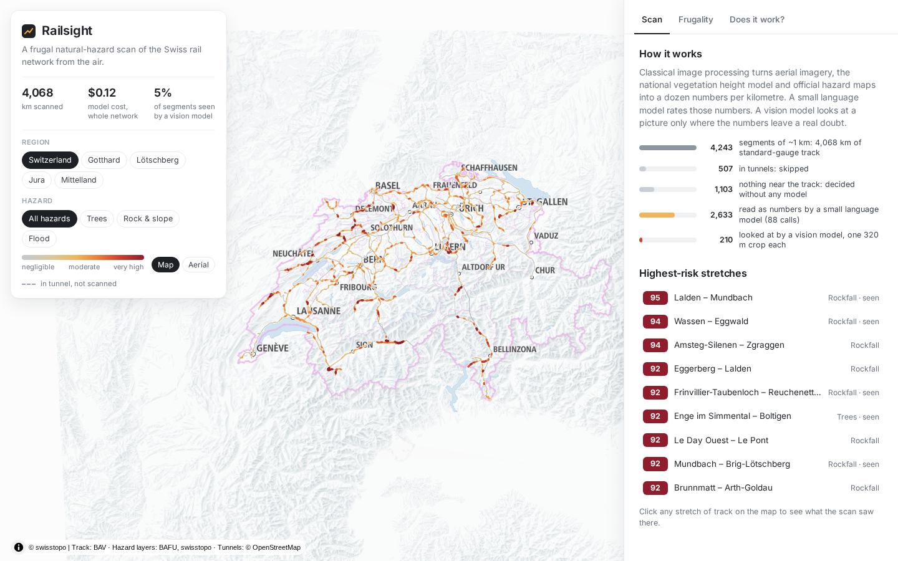
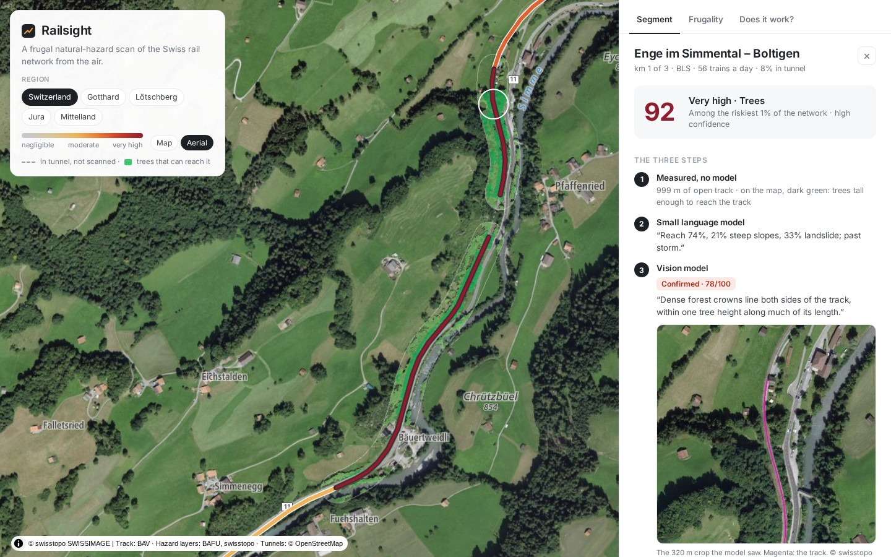

# Railsight

**A frugal natural-hazard scan of the Swiss rail network from the air.**
LauzHack 2026 · AXA challenge *Frugal use of Multimodal AI*.



## What it is

Fallen trees, rockfall, landslides, debris flows and floods stop Swiss trains every week. For an insurer such as AXA,
the natural-hazard exposure of infrastructure is what has to be priced, and today it is assessed by people walking the
line or, with AI, by sending every aerial image to a large model. Railsight rates every kilometre of the
4,068 km of standard-gauge track in Switzerland for these hazards for **$0.116 in model costs**, by turning images
into numbers first and calling a model only where it adds something: a small language model reads the numbers, and a
vision model looks at a picture for only 4.9 % of the kilometres. The web app shows the network coloured by
risk; click a kilometre to see what each step saw, what it cost, and the incidents recorded there.



## The frugal architecture

```
BAV track geometry ──► 4,243 segments of ~1 km (4,068 km)
                          │
                          ├─ in a tunnel (OpenStreetMap) ─────────────────► 507 skipped, no model
                          ▼
STEP 1  classical image processing, no model (130 ms per segment on one CPU core)
        rasterise the track, distance transform, decode each map's legend colours into numbers:
        vegetation height model ─► trees >= 5 m at 4-15 m, trees >= 15 m at 15-35 m, share of the track that
                                   trees are tall enough to reach, height of the tall trees
        slope classes > 30°     ─► share of ground steeper than 30° / 40° within 150 m
        SilvaProtect, Aquaprotect ► share of the 60 m corridor in rockfall / landslide / debris-flow / 100-year flood areas
                          │
                          ├─ no tall trees reach the track, flat, no hazard area, no incident history
                          │                                              ─► 1,103 decided by a rule, no model
                          ▼
STEP 2  Claude Haiku 5.5 reads the numbers as a table, 30 segments per call, structured output, no thinking:
        risk 0-100 on an anchored scale, dominant hazard, confidence, a 14-word rationale, "look" flag
                                                       ─► 2,633 segments in 88 calls, 342,680 tokens, $0.096
                          │
                          ├─ flagged, or risk >= 70 without high confidence (capped at 8 %)
                          ▼
STEP 3  Claude Haiku 5.5 vision: ONE 320 m SWISSIMAGE crop (~390 px) at the spot step 1 found worst,
        one hazard-specific question, confirm or reject   ─► 210 segments, 151,705 tokens, $0.020
```

| | |
|---|---|
| Model cost, whole network | **$0.116** (494,385 tokens) |
| Cost per 100 km | **$0.0029** |
| Same job, every km as one 1,024 px image to Claude Opus 5.5 (measured on 12 random km) | $0.575 per 100 km, **201× more** |
| Segments decided without any model | 38 % |
| Segments a vision model looked at | 4.9 % |
| Latency | step 1 130 ms per km; text call (30 km) 6.8 s; vision call 1.2 s; Opus, one image 2.2 s |

Why it is cheap:

- **Images become numbers before a model sees them.** A dozen numbers per kilometre cost about 40 tokens; one aerial
  image of the same kilometre costs about 1,100 for Opus.
- **Measure, don't guess.** Our first step 1 classified tree canopy on the orthophoto (excess-green, darkness,
  texture). Checked against the forest inventory's vegetation height model on 60 random km, it found 78 % of
  the trees but only 17 % of what it called canopy was vegetation over 3 m: meadows and green rivers look like
  crowns from above (`pipeline/validate_canopy.py`). Step 1 now decodes the height model, which the inventory derives
  from aerial stereo images, and gets heights for free: a tree is a hazard if it is taller than its distance to the
  track.
- **Only tiles that matter are fetched**, once, then cached: those touching a corridor around open track (40 m for
  trees, 150 m for slopes, 60 m for hazard maps). 27,895 tiles, 455 MB for the whole network.
- **The vision model gets one small crop and one question** ("do tall trees stand within a tree height of the
  track?", "is there bare rock above the track?"), only where the numbers left a doubt.

Every call is logged with tokens, cost and latency; the app's *Frugality* tab shows the totals and each kilometre shows
what it cost.

## Data sources

| Source | Licence / attribution | Feeds |
|---|---|---|
| Federal rail network (Schienennetz), BAV, as prepared by our [sbb-twin](https://github.com/LauzTakt/sbb-twin) | open government data, © BAV | track geometry, segments, sections between stations |
| SWISSIMAGE orthophotos | © swisstopo (geo.admin.ch, free use with attribution) | step 3 crops, the app's aerial view |
| Slope classes over 30° | © swisstopo | step 1: steep ground |
| Vegetation height model, Swiss National Forest Inventory (LFI) | © BAFU / WSL | step 1: tree heights near the track |
| SilvaProtect-CH (rockfall, shallow landslides, debris flows), Aquaprotect 100-year floods | © BAFU | step 1: official hazard areas |
| Railway tunnels, one Overpass query | © OpenStreetMap contributors, ODbL | tunnel gate |
| SBB liveticker export (March 2024 - October 2026), provided at LauzHack 2026 | public passenger information; only date, cause and section are published here | incident history (step 2, 2024-25 only) and the evaluation |
| Swiss light base map | © swisstopo | the app's map |

Tiles were fetched once at no more than 12 requests per second and are cached locally, not committed.

## Reproduce the scan

Requirements: Python 3.12 with numpy, scipy, pillow, requests and anthropic; the environment variable
`ANTHROPIC_API_KEY`; the BAV network and incident files prepared by sbb-twin (paths in `pipeline/common.py`).

```sh
cd pipeline
python segments.py         # BAV network -> ~1 km segments; tunnel parts from OpenStreetMap
python fetch.py 12         # WMTS tiles around open track, <= 12 requests/s, cached in cache/tiles
python features.py         # step 1, no model
python incidents.py        # SBB incidents -> track sections; trains per day per edge
python assess.py           # steps 2 and 3
python assess.py terrain   # evaluation variant: step 2 without any incident history
python naive.py 12         # measured baseline: 12 km as images to Claude Opus 5.5
python evaluate.py         # the checks below
python export.py           # app/public/data, masks, crops
```

`run_all.sh` runs them in order. Runtime: about 50 minutes of polite tile downloads the first time (455 MB), then
about 9 minutes of image processing on one core and about 5 minutes of model calls (4 in parallel). Cost of one
full run: $0.116 for the scan, $0.094 for the evaluation variant and $0.066 for the Opus baseline.

## Run the app

```sh
cd app && npm install && npm run dev                 # http://127.0.0.1:5481
cd pipeline && PORT=5482 python server.py            # optional: live "Re-scan" of one km (needs the key)
```

**Docker / Coolify.** The app is static: the scan results are JSON and images in `app/public`, and no model is called
at runtime. `docker build -t railsight . && docker run -p 8080:80 railsight` builds it and serves it with nginx; on
Coolify, point a Dockerfile deployment at this repository (port 80). Base map and aerial tiles load from geo.admin.ch in
the browser. The re-scan button only appears when `pipeline/server.py` runs next to the dev server.

## Does it work?

An incident is only known per station-to-station section, so each one is spread evenly over the open segments of its
section; repeated reports of one event count once. Natural-hazard incidents are those with the causes fallen tree,
storm damage, storms, strong wind, obstacle on the track, landslide, rockslide, falling rocks or flooding, plus
incidents filed under another cause whose texts name a fallen tree, a branch or an obstacle. The question: what share
of the incidents falls on the top 5 / 10 / 20 % of open track by each ranking? A random ranking catches 5 / 10 / 20 %.
Intervals: 95 % bootstrap over incidents.

**All years, terrain only (main check, n = 32).** Every natural-hazard incident since March 2024 against the
evaluation variant of step 2, which reads only the terrain numbers, so no incident history leaks into the ranking.

| Ranking | top 5 % of track | top 10 % | top 20 % |
|---|---:|---:|---:|
| **Railsight** | 5 % (3 %-8 %) | 10 % (5 %-17 %) | 23 % (16 %-30 %) |
| Rule, no model | 5 % (2 %-9 %) | 11 % (6 %-16 %) | 22 % (14 %-30 %) |
| Traffic | 1 % (0 %-3 %) | 9 % (2 %-17 %) | 13 % (5 %-23 %) |
| Section length | 5 % (0 %-12 %) | 14 % (5 %-23 %) | 14 % (6 %-24 %) |
| Random | 5 % (2 %-9 %) | 10 % (6 %-15 %) | 21 % (17 %-26 %) |

**No better than random.** The 10 % of track the terrain-only scan ranks riskiest received 10 % of the incidents (interval 5 %-17 %), what a random ranking gets; at 5 % and 20 % the picture is the same, and the rule without any model does as well. Traffic and section length are no better. With 32 incidents known only per section, the check cannot show a signal. In 2026 the two fallen-tree and storm incidents lie on sections whose best kilometre is in the top 3 % and 6 % of the ranking, but the four obstacle incidents do not: an anecdote, not evidence.

**Out of time: 2026 only (n = 6).** The full scan saw the incidents of 2024-25 as history; this checks the
incidents of January-October 2026. Too few to conclude anything.

| Ranking | top 5 % of track | top 10 % | top 20 % |
|---|---:|---:|---:|
| **Railsight** | 4 % (0 %-10 %) | 6 % (0 %-16 %) | 12 % (2 %-26 %) |
| Text step only | 5 % (0 %-11 %) | 11 % (1 %-24 %) | 18 % (2 %-38 %) |
| Rule, no model | 2 % (0 %-5 %) | 8 % (2 %-15 %) | 21 % (7 %-38 %) |
| Incident history | 6 % (0 %-17 %) | 9 % (4 %-20 %) | 19 % (15 %-29 %) |
| Traffic | 2 % (0 %-6 %) | 8 % (0 %-22 %) | 8 % (0 %-22 %) |

Railsight ranks exposure to screen the network cheaply and say where to look first. It is not a validated predictor.

## Limits and next steps

- **Few labels**: a few dozen natural-hazard incidents in 31 months, known per section only, and only those SBB
  announced to passengers.
- **Exposure, not probability**: no weather, no protection works (nets, galleries, dams), no maintenance; the 0-100 is
  an anchored judgement of a small model, not a calibrated probability.
- **The vision step judges only what is visible**: it confirms trees and bare rock well but tends to reject slide and
  flood flags, which do not show from above (the evaluation reports the ranking with and without it).
- **Inputs**: vegetation heights come in classes (5-15 m) and their survey year varies; tunnels come from
  OpenStreetMap within 30 m plus a name rule for the base tunnels; standard gauge only.
- **Next**: multiply exposure by storm and rain forecasts (MeteoSwiss) for a daily watch list; add the metre-gauge
  networks; calibrate against SBB's internal event records, which have exact locations.

## Demo path (3 minutes)

1. **Problem** (20 s): natural hazards stop trains; insurers price exposure; scanning 4,000 km with a big vision model
   is slow and expensive.
2. **Overview** (20 s): the whole network, $0.116 in model costs, 4.9 % of the km seen by a vision model.
3. **Gotthard** (60 s): the Region button, the highest-risk stretches in view, click the top one: the aerial view with
   the trees that can reach the track, the three steps (numbers, the small model's rationale, the vision crop and
   verdict) and what this kilometre cost.
4. **Frugality** (30 s): $0.0029 per 100 km against $0.575 for Opus on every image; how many calls the
   cascade avoided.
5. **Does it work?** (30 s): the all-years terrain-only check with its interval, stated as it is.
6. **Limits and next step** (20 s).

## Team

Built at LauzHack 2026 (EPFL, 21-22 November 2026) for AXA's challenge *Frugal use of Multimodal AI*, by David Sarrat
González with AI coding agents. Everything in this repository was written during the event; it reuses the BAV track
graph and the incident timelines our team prepared earlier in the same hackathon for sbb-twin.
